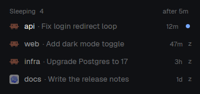

# agent-sleep



A [Herdr](https://herdr.dev) mod that puts idle coding agents to sleep to give
their memory back, and wakes them with their whole conversation in one click.

Each running agent costs a few hundred MB. With a dozen tabs of agents that
finished hours ago, that adds up to gigabytes, sometimes enough for the
kernel's OOM killer. agent-sleep quits the agents nobody is using and keeps
what is needed to resume them.

## What it does

- Every 30 s, an agent that has been **done or idle for 5 min** (configurable)
  is asked to quit, after its session id is noted. Its terminal stays open on
  the shell.
- A **Sleeping** list under the Agents list shows the sleeping agents, with
  their space, title and how long they have been asleep. An agent is always
  in one of the two lists: it shows "falling asleep…" while it quits and
  "waking…" while it starts again.
- An agent that **finished while you weren't looking** keeps its "done" dot in
  the list until you show its terminal or wake it.
- **Click one to wake it**: the agent's resume command (`claude --resume <id>`)
  is typed in its shell, and the conversation comes back where it stopped.
- Optional (`./install.sh --fit`): the Agents and Sleeping lists shrink to
  their rows, so Sleeping sits right under the agents and the spare height
  goes to Spaces.
- Click **after 5m** in the list header to change the delay: 5, 10, 20, 60 min, or off.
- Click **by space** in the list header to change the order: by space,
  longest asleep first, or newest asleep first.

An agent is left awake when:

- it is visible: focused, or in any pane of the tab on screen;
- it is shown in a window of another machine's app that runs the mod too
  (`agent-sleep.viewed`, see [Known limits](#known-limits));
- it is pinned;
- its prompt holds text you haven't sent;
- it has work running in the background, which quitting would stop: shells,
  tasks or sub-agents shown in Claude's footer (`1 shell`, `2 tasks`, a
  `◯ <agent>` row), shell processes Claude started, or Claude's own status
  (in `~/.claude/sessions/<pid>.json`) being anything but `idle`: it says
  `busy` while a background sub-agent runs and `shell` while background
  shells run.
- it wasn't started from a shell (quitting would close its terminal);
- it runs on another machine (`hc machine`): that machine's copy of the mod
  handles it (see below).

"Visible" counts every window of the Herdr app running the mod. All of these
are checked again right before the quit is typed, and for an idle agent the
quit is refused if the agent started working meanwhile. See
[Known limits](#known-limits) for the few cases this doesn't cover.

## Supported agents

| Agent | Status | Quits with | Wakes with |
|---|---|---|---|
| Claude Code | supported | `/exit` | `claude --resume <id>` |
| Codex | **experimental**, untested | `/quit` | `codex resume <id>` |

Other agents can be added in [`mods/agent-sleep/adapters.js`](mods/agent-sleep/adapters.js):
an adapter says how to find the session of a running process, how to spot a
draft in the prompt, how to quit and how to resume.

## Claude Code: turn prompt suggestions off

Claude Code fills its empty prompt with a grey **suggested next prompt**.
agent-sleep can't tell that grey suggestion from text you typed, and to never
lose a draft it keeps the agent awake. **With suggestions on, most Claude agents never sleep.**

Turn them off in `~/.claude/settings.json`:

```json
{ "promptSuggestionEnabled": false }
```

or in Claude Code with `/config` → Prompt suggestions, or for one session with
`CLAUDE_CODE_ENABLE_PROMPT_SUGGESTION=false`. Agents already running may need
a restart to pick it up.

Real drafts are still protected: an agent with text you typed in its prompt
stays awake.

## Install

Needs the Herdr app running, and `python3`.

```sh
git clone <this repo> && cd herdr-agent-sleep
./install.sh            # the layout shown now
./install.sh main       # or a given layout
./install.sh --fit      # also size the lists to their rows
```

The script copies the mod to `~/.config/herdr-app/mods/agent-sleep` and adds
the Sleeping list under the Agents list. Herdr's own layouts are read-only, so
a shipped one (`main`, `terminals`, `win98`) is first duplicated as
`<name>-sleep`, and Herdr switches to it. `ctrl-shift-l` switches back.
The mod is checked before it replaces an older copy, and the layout is saved
first: both backups go to `~/.config/herdr-app/.agent-sleep-backup/`.

Without the script: copy `mods/agent-sleep` into `~/.config/herdr-app/mods/`
and add this block to one of your layouts, for example after the `agents`
block:

```json
{ "id": "agent-sleep", "type": "block", "size": { "weight": 0.5 }, "content": { "mod": "agent-sleep" } }
```

Block props: `"fit": true` sizes the Agents and Sleeping blocks to their rows
(it resizes the `agents` block, replacing your own size for it); `"demo": true`
shows sample rows and does nothing (used for `preview.png`).

## Uninstall

```sh
./uninstall.sh
```

Quit the Herdr app first: your terminals keep running (herdr-core), and no
copy of the mod runs while its settings are removed. The script removes the
labels it left on terminals (finished ones included), its block from every
layout, its shared settings (delay, order) and the mod. Agents asleep at that moment
stay on their shell: their resume commands, with the folder to run them in,
are printed and saved in
`~/.config/herdr-app/.agent-sleep-backup/<date>/sleeping.txt` before any
label is removed. With `--fit`, the Agents block keeps its last size: drag it
back to taste.

## How it works

State lives on each terminal as herdr-core labels, so it survives app
restarts and every copy of the mod agrees (`hc get <t>` shows them):

| Label | Value |
|---|---|
| `agent-sleep` | session id |
| `agent-sleep.agent` | adapter (`claude`, `codex`) |
| `agent-sleep.title` | the agent's title when it fell asleep |
| `agent-sleep.since` | when it fell asleep (ms) |
| `agent-sleep.unseen` | `1` if it had finished unseen (status `done`) |
| `agent-sleep.state`, `agent-sleep.at` | `quitting` or `waking`, and since when |
| `agent-sleep.prompt` | the shell's last line when the agent fell asleep |
| `agent-sleep.waker` | which copy of the mod is waking it (two windows clicking at once) |
| `agent-sleep.cwd` | the agent's folder, for the commands `uninstall.sh` saves |

The labels are written **before** the quit is typed, so a slow quit or an app
reload never loses the session id; the next check finishes the job. A quit
that hasn't happened after 2 min is given up. A wake clears the labels only
once the agent runs again; if it hasn't after 2 min, it goes back to the list.
Typing the resume command yourself works too: hover a row to see it.

The shell's line belongs to you: nothing is typed there when an agent falls
asleep, and a wake types the resume command only if the line is exactly as it
was then, checked right before typing. Its tab comes up at the click; if you
type there before the command goes in, the check sees it. If you typed
something there (or your prompt changes by itself, like a clock), a toast
gives you the command to run instead.

Only well-formed session ids (UUIDs) are ever typed into a shell, so a label
set by something else can't run a command.

## Known limits

Typing at the wrong moment:

- If you start typing into an agent in the second between the last check and
  the quit, the quit is sent after your text, which submits both as a prompt.
- An agent marked done (finished, not looked at yet) has no last-moment guard
  against starting work again: the checks a moment before the quit are all
  there is.
- The quit and the resume wait for a pause in your typing. If you keep typing
  elsewhere for a long time, they can be sent well after the last check.
- When you wake an agent, text typed into its shell in the instant between
  the last check and the command goes in before the command.

Other windows and clients:

- Visibility is shared between copies of the mod in the same app (same
  `~/.config/herdr-app`). A window of another machine's app that shows one of
  this machine's terminals writes the time on it (`agent-sleep.viewed`, every
  15 s, removed once no window shows it, unless another machine's app wrote it
  since), and this machine's copy leaves it awake for 105 s after, and records no shell line for it. That needs the mod
  on both machines and clocks less than 90 s apart. Removal is best effort
  (on app quit, or when the other machine became unreachable): a label left
  behind keeps the agent awake for those 105 s, then counts for nothing; that
  machine's `uninstall.sh` removes it. An agent shown
  only in a client without the mod (or a second app instance on the same
  machine) counts as not visible and can be put to sleep.
- An agent shown in a floating terminal window or a peek, or shown in place
  of an unfocused pane's terminal, counts as visible only while it has focus.
- Text typed or sent into a sleeping agent's shell by other means (another
  client, `hc send` from a script or another agent) in the first 10 seconds
  after it quit can be recorded as the shell's prompt; a wake would then run
  it with the resume command.

Agents and shells:

- Claude Code's prompt suggestions keep agents awake: see
  [above](#claude-code-turn-prompt-suggestions-off).
- Only agents started inside a shell can sleep: the shell is what stays.
- The resume command runs in the shell's current folder. Claude Code looks up
  sessions by folder: if you `cd` elsewhere in that shell, wake fails and the
  agent goes back to the list.
- Starting a new agent (not a resume) in a sleeping agent's shell replaces it
  in the list; a toast gives the earlier session's resume command.
- The session id is read when the agent falls asleep. If an agent switched
  conversations in place (`/clear`, `/resume`) and the agent doesn't update
  its session record, the id may point to the earlier conversation.
- Once asleep, an unseen agent's dot shows only in the Sleeping list, not on
  its space and tab (the agent no longer reports a status).
- Background work is detected from what Claude Code shows and reports
  (footer, session status, shell children), as observed on Claude Code
  2.1.318. A later version that shows it differently may need an update.
- Agents on other machines (`hc machine`) are put to sleep only by the mod
  running on their machine. This copy lists them (with the machine's name,
  read every 30 s) and wakes them.
- Linux and macOS. Codex session lookup reads `/proc` and is Linux only.

## License

[MIT](LICENSE)
