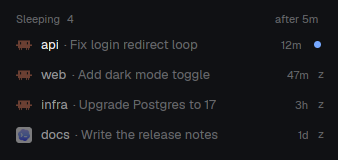

# agent-sleep

A "Sleeping" list under the Agents list. Agents that have been done or idle
for a few minutes quit to free their memory and show up there; clicking one
resumes it with its whole conversation.

## What you see

- A block under the `agents` block of the sidebar, weight 0.5 next to its
  weight 1, background `chrome`, text 13 px.
- Header, 30 px high, 16 px side padding, text 11 px medium `dim`:
  "Sleeping", the count, and on the right two chips: the order ("by space",
  "longest" or "newest") and the delay ("after 5m", or "off").
- One row per sleeping agent, 30 px high, radius 8, hover `hover`: the
  agent's icon (`icons/claude.svg`, `icons/codex.svg`) at 45 % opacity, the
  space name in `muted` (max 120 px), "· title" in `dim`, the time asleep
  in 11 px `dim` (`<1m`, `4m`, `2h`, `1d`), and a small "z", or, for an agent
  that finished unseen, a 7 px `done` dot instead and the space name in
  `foreground`.
- A row being put to sleep shows "falling asleep…" instead of the time (not
  clickable); a row being woken shows "waking…".
- Empty list: "Idle agents sleep after 5 min." (or "Sleep is off.").

## How it behaves

- Every 30 s (one run at a time, one copy at a time), for each local agent
  with status `done` or `idle`: skip it if it is visible (`focused()` terminal,
  shown and agent, every pane of `focused().tab`, every `content.terminal`
  block of the shown layout outside hidden nodes and inactive stack children,
  plus what other copies announced in shared `agent-sleep.visible`: each copy
  rewrites its own entry on change and every 15 s, entries older than 45 s
  are ignored, `close()` removes it), shown in another machine's app
  (`agent-sleep.viewed` within 105 s, either way: 15 s between writes plus
  90 s of clock difference), pinned, not idle for
  longer than the delay (`status_ms`), not a child of a shell (`argv[0]` is a
  shell and `foreground.pid != pid`), not matched by an adapter, without a
  well-formed session id, started less than the delay ago, with a draft in
  its prompt (text after `❯`, or on the lines below it up to the box border),
  or with background work (Claude's footer after the box border matches
  `N shell(s)/task(s)/loop(s)/job(s)` or has a `◯ <agent>` row, or
  `pgrep -P <pid>` lists a shell child: quitting would kill them). The
  footer's `← N agents` is ignored: it also counts finished sub-agents.
  A login shell's `-` prefix (`-bash`) is ignored. Also skipped: Claude's own `status` in `~/.claude/sessions/<pid>.json`
  other than `idle`. Observed on Claude Code 2.1.318: a background sub-agent
  → `busy` there, `working` in Herdr, footer row `◯ general-purpose  <desc>`;
  background shells only → `shell` there, `done` in Herdr, footer `2 shells`. The screen is read with `hc read` and no
  history (`--lines 0`), which never scrolls a full-screen program. Re-check all of that, and that the foreground pid is the one the
  session came from, right before acting.
- Then: write the labels with `agent-sleep.state=quitting`, type the quit
  command (`hc send --if idle` for an idle agent, so it is refused if the agent
  started working; a refused or failed send keeps `quitting`, and
  settle() decides after 2 min), wait up to 15 s (`cx.sleep`) for a shell in the foreground, then
  clear the state, set `agent-sleep.since`, and record the shell's last
  non-empty line in `agent-sleep.prompt` once two reads 500 ms apart agree
  (the prompt is drawn a moment after the quit), only within 10 s of the quit
  and only while the terminal isn't visible, here or in another machine's app
  (`agent-sleep.viewed`, read again before each read): later, the person may have typed
  there. Not recorded → a wake falls back to the toast. Nothing is typed into
  the shell. The label write is checked: if it fails, no quit is sent.
- List: labelled terminals with a valid session and a known adapter; a
  `quitting` or waking one only while it is not in `agents()`. In
  `agents()` means awake (a sleeping agent, back on its shell, reports no
  status), so each agent is in exactly one of the two lists.
- Each check also settles labelled terminals: `quitting` and on its shell →
  finish as above; `quitting` with a missing or malformed `agent-sleep.at`
  (written with the state in one call, so tampered with) → timed out; `quitting` for over 2 min → drop the labels if the agent
  still runs (with the "replaced" toast if it runs another session), else finish as above (it quit, then something else started); agent running again → drop the labels (woken), with a toast giving the old resume command if the
  running session is a different one; running but no session yet → note the time in
  `agent-sleep.at`, and after 2 min (a trust question) drop the labels, with
  the same toast unless it was waking; back on the shell after that → clear
  `agent-sleep.at`; `waking` for
  over 2 min with the agent not running → back to asleep; asleep with no
  recorded prompt → try again, still only within 10 s of the quit, and not
  while another machine's app shows it (fresh `agent-sleep.viewed`, read again
  before each read of the line). An unknown `agent-sleep.agent` is left alone (and not listed). A failed `hc get` changes
  nothing. A malformed session id → drop the labels.
- An agent whose Herdr status (`agents()`) was `done` (finished unseen) when it fell asleep gets
  `agent-sleep.unseen=1`; showing its terminal or waking it clears it.
- Click a row: show "waking…" (local state, kept until the agent runs, so
  no flicker) and focus its terminal at once. Then wait up to 10 s for a
  check that holds the terminal; past that, or if `hc get` or a label write
  fails, the toast. If the session label still matches the row, no state is
  set (not already waking), a shell is in the foreground and a prompt line is
  recorded: write `state=waking` with `agent-sleep.waker=<copy id>`, re-read
  it (another window may have clicked too: only the last writer types), read
  the shell's last line once more and, if it is still exactly
  `agent-sleep.prompt` (nothing typed there, including since the focus),
  type the resume command (UUID-checked) and clear `agent-sleep.unseen`. On a
  mismatch or a failed send the state goes back to asleep, unseen kept, with
  the toast. After the send, poll every 250 ms (up to 30 s) and drop the
  labels as soon as the agent runs with that session. A waking row whose
  terminal is back in `agents()` (a sleeping one, on its shell, isn't) is
  hidden at once.
- Terminals of another machine shown in this window (same set as above) get
  `agent-sleep.viewed=<ms>` when they show up and every 15 s after, so that
  machine's copy leaves them awake; once no window of this app shows one
  (other copies' fresh `agent-sleep.visible` entries, this copy's own view
  left out), the label is removed if it still holds this copy's last write
  (otherwise another machine's app shows it too) and this window doesn't show
  it again by then (if it does, the label is rewritten instead). Each terminal gets its own
  spawned task (one at a time per terminal, a task stuck over 60 s no longer
  blocks the next), spawned and never awaited in `render()`: when `render()`
  sees the shown set change (and at each render while a write was held
  back: machine not ready yet, a task still running; a write that failed
  is retried at most every 15 s), or by the 15 s timer,
  which rewrites every shown one; terminals of a machine not `ready` in
  `machines()` are left alone. `close()` removes this copy's labels all at
  once, even of terminals still on screen, best effort (it gets little time on quit): a label left behind
  expires after 105 s.
- Click the order chip: by space (Herdr's terminal order) → longest asleep
  first → newest asleep first (shared key `agent-sleep.sort`, so every copy
  agrees). A row falling asleep, with no sleep time yet, counts as asleep
  since now.
- Click the delay chip: delay cycles 5 → 10 → 20 → 60 → off (shared key
  `agent-sleep.delay`, so every copy agrees).
- Click "Sleeping": fold or unfold the list.
- `close()` drops this copy's entry and stale ones from `agent-sleep.visible`
  (null once empty) and releases the lead if it held it.
- `uninstall.sh` refuses to run while the app runs (`herdr-app status`
  answers, a `herdr-app` process exists, or its socket accepts a connection): no
  copy of the mod runs then, and the app can't write `shared.json` back.
  Terminals keep running in herdr-core. Then: for every local terminal of
  `hc ls --all` (finished ones keep labels; `hidden_finished` or a failed `hc`
  is reported, never read as "nothing to do") with a UUID session and a known
  agent, print and save its folder (`agent-sleep.cwd`, else the terminal's)
  and resume command in `.agent-sleep-backup/<date>/sleeping.txt`: one per
  session, the live terminal first. A session an agent seems to run right now
  in any terminal (Claude: `~/.claude/sessions/<pid>.json`, Codex: its open
  rollout file) is still saved, with a note: a quit under way or a stale
  record must never lose it. Without `agent-sleep.cwd` (an older version), the
  terminal's folder is given, marked as maybe not the agent's. Labels of an agent the script doesn't know are left, with a
  message. Only if that file is written, clear the labels of the others.
  Then strip the block from every layout, remove every `agent-sleep.*` key
  from `shared.json`, remove the mod. Each step reports its failure; running
  it again is safe. Its resume commands mirror `adapters.js`.

## Built from

- Layout: one block `{ "id": "agent-sleep", "type": "block", "size": { "weight": 0.5 }, "content": { "mod": "agent-sleep" } }`
  after the `agents` block (props `{ "fit": true }` with `install.sh --fit`).
  Shipped layouts are read-only: `install.sh` clones `main` to `main-sleep`
  first, checks the mod in a staging folder, backs up the layout and the old
  mod, and writes the layout atomically.
- `mods/agent-sleep/main.js`: the view and the engine. `herdr` functions:
  `agents()`, `terminals()`, `panes()`, `spaces()`, `focused()`, `theme()`,
  `layout()`, `props()`, `run("pane.focus" | "layout.resize")`,
  `hc([...])` (`get --json`, `read` (screen only, no history), `send`, `label`),
  `shared` / `setShared`, `notify`, `nextCommand()`; `cx.sleep`, `cx.timer.every`.
- `mods/agent-sleep/adapters.js`: one adapter per agent, plus `isSessionId`:
  - Claude Code: `app == "claude-code"`, foreground `claude`; session from
    `~/.claude/sessions/<pid>.json` (`sessionId`, `startedAt`); draft = text
    after `❯` on the last prompt line or on the lines below it up to the `─`
    border; background work = footer `N [background] shell(s)/task(s)/…` or a
    shell child process; `/exit`; `claude --resume <id>`.
  - Codex (experimental): `app == "codex"`, foreground `codex`; session = the
    uuid of the `rollout-*.jsonl` file the process holds open
    (`exec("ls", ["-l", "/proc/<pid>/fd"])`); draft after `›`; `/quit`;
    `codex resume <id>`.
- State: terminal labels `agent-sleep` (session id), `agent-sleep.agent`,
  `agent-sleep.title`, `agent-sleep.since`, `agent-sleep.unseen`,
  `agent-sleep.state` + `agent-sleep.at`, `agent-sleep.prompt`,
  `agent-sleep.waker`, `agent-sleep.cwd` (the agent's folder, written with the
  others before the quit), `agent-sleep.viewed` (written by another machine's
  copy showing it). `settle()`
  reads them fresh from `hc get`, never from the list it started from.
- Block props `demo: true`: sample rows (`api`, `web`, `infra`, `docs`), no
  timer, no actions. `preview.png` is a shot of it, so no real work shows.

## Watch out

- Several copies of the mod (one per layout) would act twice: one copy leads
  (shared key `agent-sleep.leader`, refreshed every tick, taken over after
  45 s of silence), and a busy set is claimed before any `await`.
- `cx.timer.every` counts from the end of its handler, but the handler only
  spawns: guard the run with a flag or runs overlap.
- Labels before the quit, never after: a quit that outlives the wait (or an
  app reload) must not lose the session id.
- Session ids are typed into a shell: accept UUIDs only, everywhere.
- Never type into a sleeping terminal's shell unless its last line is the one
  recorded at sleep time: `hc send` pastes after whatever the person typed
  there, and presses Enter. A shell prompt that changes by itself (a clock)
  just falls back to the toast.
- The leader refreshes its claim at every agent it handles, not only once per
  tick: a long first run must not let another copy take over. And it never
  takes the lead back: if another copy holds it, the run stops. `close()`
  releases the lead. `shared` persists: after a reload without `close()`,
  the next copy waits up to 45 s for the old entry to go stale.
- `hc send` waits for the person to pause typing, then pastes: if they start
  typing into that agent in the second after the last check, the quit lands
  after their text. Narrow the window (re-check just before), don't claim it
  is closed.
- Removing `agent-sleep.viewed` checks that it still holds this copy's write,
  then clears it: two calls, not atomic. Another machine's app writing in
  between loses its label until its next write (15 s). Labels have no
  compare-and-set; keep the gap to those two calls.
- `hc send` from inside an agent's terminal wraps the text in `<hc from=…>`
  tags; from the app (a mod) it doesn't. Test wake from the mod.
- The prompt marker check is deliberately conservative: no marker found
  counts as a draft. Claude Code's grey prompt suggestions read as drafts
  too (`hc read` has no colors): users turn them off.
- Never send ctrl+c or esc to clear the prompt: that discards a draft.
- An agent that is its terminal's own program (`hc run -- claude`) ends the
  terminal when it quits: skip it.

## Done when

- `herdr-app check mods/agent-sleep` passes.
- An idle Claude Code agent not on screen quits after the delay, shows in
  Sleeping with its title and a growing time; its shell line is untouched.
- Clicking it resumes the same conversation and the row goes.
- An agent with text in its prompt, a visible agent, a pinned agent and an
  agent that is its terminal's own program stay awake.
- Setting `agent-sleep=$(id)` on a terminal by hand doesn't list it, and
  clicking never types it.
- "off" stops new sleeps; already sleeping agents stay listed.
- With the mod on two connected machines, an agent of one shown in the other's
  window stays awake.
