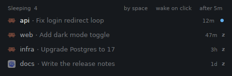

# agent-sleep

A "Sleeping" list under the Agents list. Agents that have been done or idle
for a few minutes quit to free their memory and show up there; clicking one
resumes it with its whole conversation.

## What you see

- A block under the `agents` block of the sidebar, weight 0.5 next to its
  weight 1, background `chrome`, text 13 px.
- Header, 30 px high, 16 px side padding, text 11 px medium `dim`:
  "Sleeping", the count, and on the right three chips: the order ("by
  space", "longest", "newest" or "by folder"), how agents wake ("wake on
  click" in `dim`, or "wake on focus" in `foreground`) and the delay ("after
  5m", or "off").
- In "by folder", a 24 px header above each group, 8 px side padding, 11 px
  `dim`: a 10 px tile with 3 px corners in the folder's color (the
  space-folders avatar colors, `dim` without one), the folder's name in
  `muted`, the machine whose folder it is (another machine's) in 10 px, a
  7 px `done` dot while folded with an agent in it that finished unseen, the
  group's count, and a 10 px chevron in `dim` (Herdr's
  `mods/workspace-chrome/chevron-down.svg`, `chevron-right.svg` folded);
  radius 6, hover `hover`. The last group, "No folder", has a `border` tile.
  A folded group shows its header only.
- One row per sleeping agent, 30 px high, radius 8, hover `hover`: the
  agent's icon (`icons/claude.svg`, `icons/codex.svg`) at 45 % opacity, the
  space name in `muted` (max 120 px), "· title" in `dim`, for an agent of
  another machine its name in 10 px `dim`, the time asleep
  in 11 px `dim` (`<1m`, `4m`, `2h`, `1d`), and a small "z", or, for an agent
  that finished unseen, a 7 px `done` dot instead and the space name in
  `foreground`.
- A row being put to sleep shows "falling asleep…" instead of the time (not
  clickable); a row being woken shows "waking…".
- Empty list: "Idle agents sleep after 5 min." (or "Sleep is off.").

## How it behaves

- Every 30 s (one run at a time, one copy at a time), for each local agent
  with status `done` or `idle`: skip it if it is visible (`focused()` terminal,
  shown and agent, every pane of `focused().tab`, every `content.terminal`
  block of the shown layout outside hidden nodes and inactive stack children,
  a terminal that had the keyboard outside the layout (a peek, a window: no
  `pane`) within the last 10 min, unless since focused in a pane,
  plus what other copies announced in shared `agent-sleep.visible`: each copy
  rewrites its own entry on change and every 15 s, entries older than 45 s
  are ignored, `close()` removes it), shown in another machine's app
  (`agent-sleep.viewed` within 105 s, either way: 15 s between writes plus
  90 s of clock difference), pinned, not idle for
  longer than the delay (`status_ms`), not a child of a shell (`argv[0]` is a
  shell and `foreground.pid != pid`), whose parent (`ps -o ppid=`) isn't a
  shell with nothing queued after the agent (its argv: the terminal's own, or
  `/proc/<ppid>/cmdline`; a `-c` script other than Herdr's launcher
  `"$@"; exec "$0" -i` would run the rest at the quit, so is skipped; can't
  read it → skipped), not matched by an adapter, without a
  well-formed session id, started less than the delay ago, with a draft in
  its prompt (text after `❯`, or on the lines below it up to the box border),
  or with background work (Claude's footer after the box border matches
  `N shell(s)/task(s)/loop(s)/job(s)` or has a `◯ <agent>` row, or
  `pgrep -P <pid>` lists a shell child: quitting would kill them). The
  footer's `← N agents` is ignored: it also counts finished sub-agents.
  A login shell's `-` prefix (`-bash`) is ignored. Also skipped: Claude's own `status` in `~/.claude/sessions/<pid>.json`
  other than `idle`. Observed on Claude Code 2.1.318: a background sub-agent
  → `busy` there, `working` in Herdr, footer row `◯ general-purpose  <desc>`;
  background shells only → `shell` there, `done` in Herdr, footer `2 shells`. The screen is read with `hc read` and no
  history (`--lines 0`), which never scrolls a full-screen program. Re-check all of that, and that the foreground pid is the one the
  session came from, right before acting.
- Then: write the labels with `agent-sleep.state=quitting`, type the quit
  command (`hc send --if idle` for an idle agent, so it is refused if the agent
  started working; a refused or failed send keeps `quitting`, and
  settle() decides after 2 min), wait up to 60 s (`cx.sleep`; exit hooks can
  be slow) for its shell in the foreground (the pid in `agent-sleep.shell`,
  written with the other labels: no other shell is ever read or typed into),
  then clear the state, set `agent-sleep.since`, and record the shell's last
  non-empty line, whole, in `agent-sleep.prompt` once three reads 500 ms apart
  agree, it isn't the agent's own last line from before the quit, and it is
  at most 1000 characters (the prompt is drawn a moment after the quit, after
  the shell's rc files), only within 10 s of the quit (of the shell coming up,
  when this copy watched the quit)
  and only while the terminal isn't visible, here or in another machine's app
  (`agent-sleep.viewed`, read again before each read): later, the person may have typed
  there. Not recorded → a wake falls back to the toast. Nothing is typed into
  the shell. The label write is checked: if it fails, no quit is sent.
- List: labelled terminals with a valid session and a known adapter, not in
  `agents()`, and for another machine's, only while that machine is ready.
  In `agents()` means awake (a sleeping agent, back on its shell, reports no
  status), whatever the labels say, so each agent is in exactly one of the
  two lists.
- Each check also settles labelled terminals: `quitting` and on its shell →
  finish as above; `quitting` with a missing or malformed `agent-sleep.at`
  (written with the state in one call, so tampered with) → timed out; `quitting` for over 2 min → drop the labels if the agent
  still runs (with the "replaced" toast if it runs another session), else finish as above (it quit, then something else started); agent running again → drop the labels (woken), with a toast giving the old resume command if the
  running session is a different one; running but no session yet → note the time in
  `agent-sleep.at`, and after 2 min (a trust question) drop the labels, with
  the same toast unless it was waking; back on the shell after that → clear
  `agent-sleep.at`; another agent there, one the labels' adapter doesn't
  recognise (in `agents()`, not on a shell) → timed the same way, then the
  "replaced" toast and the labels dropped; `waking` for
  over 2 min with the agent not running → back to asleep; asleep with no
  recorded prompt → try again, still only within 10 s of the quit, and not
  while another machine's app shows it (fresh `agent-sleep.viewed`, read again
  before each read of the line). A `waking` state is timed from when this copy
  first saw it, not from `agent-sleep.at` (written with the clock of the
  machine that clicked). That time is kept per copy: a new leader or an app
  restart starts timing again. An unknown `agent-sleep.agent` is left alone (and not listed). A failed `hc get` changes
  nothing. A malformed session id → drop the labels.
- An agent whose Herdr status (`agents()`) was `done` (finished unseen) when it fell asleep gets
  `agent-sleep.unseen=1`; showing its terminal or waking it clears it.
- Click a row: show "waking…" (local state, kept until the agent runs, so
  no flicker, 2 min at most: a call stuck on another machine must not leave
  the row unclickable) and focus its terminal at once. Then wait up to 10 s for a
  check that holds the terminal; past that, or if `hc get` or a label write
  fails, or the first `hc get` takes over 30 s (another machine not
  answering), the toast. If the session label still matches the row, no state is
  set (not already waking), a shell is in the foreground and a prompt line is
  recorded: write `state=waking` with `agent-sleep.waker=<copy id>`, re-read
  it 300 ms later (another window may have clicked too: only the last writer
  types; read again right before typing), read
  the shell's last line once more and, if it is still exactly
  `agent-sleep.prompt` (nothing typed there, including since the focus),
  type the resume command (UUID-checked) and clear `agent-sleep.unseen`. On a
  mismatch or a failed send the state goes back to asleep, unseen kept, with
  the toast. After the send, poll every 250 ms (up to 30 s) and drop the
  labels as soon as the agent runs with that session. A waking row whose
  terminal is back in `agents()` (a sleeping one, on its shell, isn't) is
  hidden at once.
- Terminals of another machine shown in this window (same set as above) get
  `agent-sleep.viewed=<ms>` when they show up and every 15 s after, so that
  machine's copy leaves them awake; once no window of this app shows one
  (other copies' fresh `agent-sleep.visible` entries, this copy's own view
  left out), the label is removed if it still holds this copy's last write
  (otherwise another machine's app shows it too) and this window doesn't show
  it again by then (if it does, the label is rewritten instead). Each terminal gets its own
  spawned task (one at a time per terminal, a task stuck over 60 s no longer
  blocks the next), spawned and never awaited in `render()`: when `render()`
  sees the shown set change (and at each render while a write was held
  back: machine not ready yet, a task still running; a write that failed
  is retried at most every 15 s), or by the 15 s timer,
  which rewrites every shown one; terminals of a machine not `ready` in
  `machines()` are left alone. `close()` removes this copy's labels all at
  once, even of terminals still on screen, best effort (it gets little time on quit): a label left behind
  expires after 105 s.
- Other machines' sleeping agents: every 30 s, `hc get` each live remote
  terminal not in `agents()` and keep the ones with an `agent-sleep` label
  whose agent isn't running (one running is awake, labels not yet settled).
  Machines not `ready` in `machines()` are skipped (their rows go). Machines
  are read side by side, each one's rows shown as soon as it answers; a
  machine whose earlier read hasn't answered is not read again; once that read
  is 60 s old, at the next 30 s pass (so within 90 s), its
  rows go (ready but not responding: they couldn't be woken) and a new read
  replaces the stuck one. One
  pass at a time, one still running after 60 s no longer blocks the next,
  and only the latest pass's results are kept. A remote row `waking` for
  over 2 min (timed from when this copy first saw it) with no agent running
  is put back to asleep from here (after reading it again: another window
  may have just started a new wake), as its machine's copy would: that copy may
  not be running.
  They are listed with the machine's name (tab looked up as
  `<machine>/<herdr.tab>`), hidden as soon as they are in `agents()`, and
  woken like local ones; after the send, the row goes once the agent runs:
  that machine's copy reads the session and drops the labels. The row's
  snapshot is dropped as soon as the agent runs (a read under way then is
  discarded), and read again right after (at the next pass if that
  machine's read was already under way).
- Click the order chip: by space (Herdr's terminal order, this machine's
  agents first, then other machines') → longest asleep
  first → newest asleep first → by folder (shared key `agent-sleep.sort`, so
  every copy agrees). A row falling asleep, with no sleep time yet, counts as
  asleep since now. "by folder" is offered only while the shown layout runs
  the space-folders mod and it has folders (shared `space-folders`, which
  outlives the mod in `shared.json`); otherwise, and in demo, a stored
  "folder" reads as by space.
- Click a group's header: fold or unfold it (shared key `agent-sleep.folded`,
  `{ <group key>: true }`, the key being `<machine>:<folder id>`,
  `:<folder id>` for this computer's folders, or `none` for "No folder";
  every copy agrees). Independent
  of how the spaces list folds that folder. Nothing in demo. Folded rows
  don't count in `fit`'s height. Wake on focus and the unseen marks work the
  same for a folded group's agents. A fold is kept while the group is empty:
  an agent falling asleep in it later shows only in the count. Folding drops
  the keys of this computer's folders that no longer exist, only when this
  computer's list is in shared `space-folders` (a missing list isn't an
  empty one). With every group
  folded, `fit` keeps no empty row.
- By folder: each row goes under the folder of the space-folders mod its
  space shows in, read from shared `space-folders` (`{ list, of }` per
  machine, `""` for this computer): the folder it was dragged in (`of`, by the
  id that machine knows the space by; `""` = none), else the folder whose
  rules ("Collect spaces from", comma-separated) reach deepest into the folder
  the space's first terminal works in (else where it was made). A space of
  another machine in none of that machine's folders goes in the first folder
  on this computer whose rules match the machine's name or the folder one of
  its spaces works in. Groups follow the spaces list top to bottom: this
  computer's folders, each followed by the folders of the machines it takes
  in, then the folders of the other machines (names in `.sort()` order), then
  "No folder", which holds every machine's loose spaces (rows carry their
  machine's name). Inside a group, Herdr's space order (`spaces()`). Only the
  spaces of listed rows are placed, rules compile once. Worktrees go by their
  own folder (space-folders nests them under their checkout's space, which
  needs git).
- Click the wake chip: wake on focus on or off (shared key
  `agent-sleep.wake-on-focus`, `true` for on; off by default).
- Wake on focus: when the focused pane's own terminal (`focused().terminal`
  with a `pane` and no `shown` replacement: not a peek, a window or a layout
  terminal block, which are looking, not asking) changes to a sleeping
  agent's (a row of the list, this machine or another) and is still the
  focused one 1 s later, with the window active, the agent wakes as a click
  on its row would, without moving focus. Right before typing, the shell's
  line is read twice 300 ms apart and must still be the recorded one, with
  the pane still focused. Passing through tabs (focus held under 1 s) wakes
  nothing. The first terminal seen focused (app start, a reload, even when
  focus comes back after a first render) never wakes: only a change does.
  Seen on every render; a hidden copy doesn't render, so every 15 s a focus
  render didn't see becomes the new starting point, never a wake. A row
  already waking or falling asleep is left alone. Failures stay quiet when
  the person is using the terminal (its line changed, a program in front,
  busy); the others (no line recorded, a failed read, label or send) show
  the "Wake it by hand" toast once per terminal per copy.
- Click the delay chip: delay cycles 5 → 10 → 20 → 60 → off (shared key
  `agent-sleep.delay`, so every copy agrees).
- Click "Sleeping": fold or unfold the list.
- `close()` drops this copy's entry and stale ones from `agent-sleep.visible`
  (null once empty) and releases the lead if it held it.
- `uninstall.sh` refuses to run while the app runs (`herdr-app status`
  answers, a `herdr-app` process exists, or its socket accepts a connection): no
  copy of the mod runs then, and the app can't write `shared.json` back.
  Terminals keep running in herdr-core. Then: for every local terminal of
  `hc ls --all` (finished ones keep labels; `hidden_finished` or a failed `hc`
  is reported, never read as "nothing to do") with a UUID session and a known
  agent, print and save its folder (`agent-sleep.cwd`, else the terminal's)
  and resume command in `.agent-sleep-backup/<date>/sleeping.txt`: one per
  session, the live terminal first. A session an agent seems to run right now
  in any terminal (Claude: `~/.claude/sessions/<pid>.json`, Codex: its open
  rollout file) is still saved, with a note: a quit under way or a stale
  record must never lose it. Without `agent-sleep.cwd` (an older version), the
  terminal's folder is given, marked as maybe not the agent's. Labels of an agent the script doesn't know are left, with a
  message. Only if that file is written, clear the labels of the others.
  Then strip the block from every layout, remove every `agent-sleep.*` key
  from `shared.json`, remove the mod. Each step reports its failure; running
  it again is safe. Its resume commands mirror `adapters.js`.

## Built from

- Layout: one block `{ "id": "agent-sleep", "type": "block", "size": { "weight": 0.5 }, "content": { "mod": "agent-sleep" } }`
  after the `agents` block (props `{ "fit": true }` with `install.sh --fit`).
  Shipped layouts are read-only: `install.sh` clones `main` to `main-sleep`
  first, checks the mod in a staging folder, backs up the layout and the old
  mod, and writes the layout atomically.
- `mods/agent-sleep/main.js`: the view and the engine. `herdr` functions:
  `agents()`, `terminals()`, `panes()`, `spaces()`, `machines()`,
  `focused()`, `window()`, `theme()`, `layout()`, `props()`,
  `run("pane.focus" | "layout.resize")`,
  `hc([...])` (`get --json`, `read` (screen only, no history), `send`, `label`),
  `exec("ps", ["-o", "ppid=", "-p", pid])`, `readTextFile("/proc/<pid>/cmdline")`,
  `shared` / `setShared`, `notify`; `cx.sleep`, `cx.timer.every`, `cx.spawn`.
- `mods/agent-sleep/folders.js`: the space-folders mod's placement rules
  (its `rule`, `folderOf` and `machineFolder`), mirrored: exports `MARK`
  (its avatar colors: `ansi6 #22a99a`, `ansi3 #e3814f`, `ansi4 #5b8def`,
  `ansi5 #8b7cf6`, `ansi2 #3fae6a`, `ansi1 #d9649a`), `hasFolders`,
  `placeSpaces`. Reads shared `space-folders`, `layout()` and `panes()`;
  never writes.
- Icons: `icons/claude.svg`, `icons/codex.svg` and the folder chevrons
  (`mods/workspace-chrome/chevron-down.svg`, `chevron-right.svg`) are Herdr's
  own, in its home folder; the mod ships none.
- `main.js` also reads shared `space-folders` itself (this computer's
  `list[].id`) to drop folds of deleted folders.
- `mods/agent-sleep/adapters.js`: one adapter per agent, plus `isSessionId`
  (`herdr`: `exec`, `readTextFile`, `home()`; programs: `pgrep -l -P <pid>`,
  `ls -l /proc/<pid>/fd`):
  - Claude Code: `app == "claude-code"`, foreground `claude`; session from
    `~/.claude/sessions/<pid>.json` (`sessionId`, `startedAt`); draft = text
    after `❯` on the last prompt line or on the lines below it up to the `─`
    border; background work = footer `N [background] shell(s)/task(s)/…` or a
    shell child process; `/exit`; `claude --resume <id>`.
  - Codex (experimental): `app == "codex"`, foreground `codex`; session = the
    uuid of the `rollout-*.jsonl` file the process holds open
    (`exec("ls", ["-l", "/proc/<pid>/fd"])`); draft after `›`; `/quit`;
    `codex resume <id>`.
- State: terminal labels `agent-sleep` (session id), `agent-sleep.agent`,
  `agent-sleep.title`, `agent-sleep.since`, `agent-sleep.unseen`,
  `agent-sleep.state` + `agent-sleep.at`, `agent-sleep.prompt`,
  `agent-sleep.waker`, `agent-sleep.cwd` (the agent's folder, written with the
  others before the quit), `agent-sleep.shell` (the pid of the shell it ran
  in), `agent-sleep.viewed` (written by another machine's copy showing it). `settle()`
  reads them fresh from `hc get`, never from the list it started from.
- Block props `demo: true`: sample rows (`api`, `web`, `infra`, `docs`), no
  timer, no actions (its chips change nothing). `preview.png` is a shot of it, so no real work shows.

## Watch out

- "by folder" reads another mod's shared state and copies its placement
  rules: a change to space-folders' `folderOf` or `machineFolder` must be
  mirrored in `folders.js`, or the two lists disagree; the fold cleanup in
  `main.js` relies on its `{ list: [{ id }] }` shape too. A mod can't call
  another's code.
- Wake on focus types into a shell the person just went to, maybe to use it:
  the line is read twice right before `hc send`, but typing that starts after
  the last read is pasted before the resume command (`hc send` waits for a
  pause, then pastes). Narrower than for a click, not closed. Never move
  focus from a quiet wake, and never wake from a peek or a window.
- Several copies of the mod (one per layout) would act twice: one copy leads
  (shared key `agent-sleep.leader`, refreshed at most every 5 s: each write
  re-renders every mod; taken over after 45 s of silence), and a busy set is
  claimed before any `await`. A run whose `hc` call never answers stops
  holding the lead after 5 min, and a new run starts.
- `cx.timer.every` counts from the end of its handler, but the handler only
  spawns: guard the run with a flag or runs overlap.
- The quit runs what the agent's shell has queued after it: `claude;
  ./deploy.sh` typed on one line in an interactive shell can't be seen, only
  a `-c` script can (and is skipped).
- Labels before the quit, never after: a quit that outlives the wait (or an
  app reload) must not lose the session id.
- Session ids are typed into a shell: accept UUIDs only, everywhere.
- Never type into a sleeping terminal's shell unless its last line is the one
  recorded at sleep time: `hc send` pastes after whatever the person typed
  there, and presses Enter. A shell prompt that changes by itself (a clock)
  just falls back to the toast.
- The leader refreshes its claim at every agent it handles (every 5 s at
  most), not only once per tick: a long first run must not let another copy take over. And it never
  takes the lead back: if another copy holds it, the run stops. `close()`
  releases the lead. `shared` persists: after a reload without `close()`,
  the next copy waits up to 45 s for the old entry to go stale.
- `hc send` waits for the person to pause typing, then pastes: if they start
  typing into that agent in the second after the last check, the quit lands
  after their text. Narrow the window (re-check just before), don't claim it
  is closed.
- Removing `agent-sleep.viewed` checks that it still holds this copy's write,
  then clears it: two calls, not atomic. Another machine's app writing in
  between loses its label until its next write (15 s). Labels have no
  compare-and-set; keep the gap to those two calls.
- `hc send` from inside an agent's terminal wraps the text in `<hc from=…>`
  tags; from the app (a mod) it doesn't. Test wake from the mod.
- The prompt marker check is deliberately conservative: no marker found
  counts as a draft. Claude Code's grey prompt suggestions read as drafts
  too (`hc read` has no colors): users turn them off.
- Never send ctrl+c or esc to clear the prompt: that discards a draft.
- An agent that is its terminal's own program (`hc run -- claude`) ends the
  terminal when it quits: skip it.

## Done when

- `herdr-app check mods/agent-sleep` passes.
- With space-folders and a folder holding a space with a sleeping agent,
  "by folder" shows that agent under the folder's header; without folders the
  chip never offers "by folder".
- Clicking a folder's header hides its agents and leaves the header with its
  count; clicking again shows them; another window folds it too.
- An idle Claude Code agent not on screen quits after the delay, shows in
  Sleeping with its title and a growing time; its shell line is untouched.
- Clicking it resumes the same conversation and the row goes.
- With wake on focus on, focusing a sleeping agent's pane for over a second
  resumes it; `pane.focus` there and back within half a second doesn't.
- An agent with text in its prompt, a visible agent, a pinned agent and an
  agent that is its terminal's own program stay awake.
- Setting `agent-sleep=$(id)` on a terminal by hand doesn't list it, and
  clicking never types it.
- "off" stops new sleeps; already sleeping agents stay listed.
- With the mod on two connected machines, an agent of one shown in the other's
  window stays awake; once asleep, it is listed in both, with the machine's
  name in the other, and waking it from either resumes it.
